# roc-graph-layout

A Roc package for deterministic, renderer-independent graph layout. It returns
node positions, edge routes, and drawing bounds without choosing how they are
rendered. Positions are node centers; routes are straight lines, polylines, or
chains of smooth cubic curves, and their endpoints attach to node box
boundaries so arrowheads land on the box.

**[Try the layouts in the browser](https://lukewilliamboswell.github.io/roc-graph-layout/)**
— edit the graph data and settings, inspect the generated SVG and geometry, or
browse the [versioned API documentation](https://lukewilliamboswell.github.io/roc-graph-layout/docs/).

The supported end-to-end layouts:

- `Layered` — directed flows such as dependencies, pipelines, and process
  diagrams, with orientation-preserving cycle handling, exact layer
  assignment, balanced coordinates, sparse position hints, and exact pins;
  `Layered.layout_exact` swaps the
  crossing-reduction heuristic for an effort-capped exact search that reports
  whether optimality was proven. `Layered.layout_grouped` coordinates nested
  directed groups, with measured boxes, labels and independent child directions;
  see the [grouped flow example](examples/grouped_flow/main.roc).
- `Tree` — input that is already a hierarchy, drawn level by level
  (`Tree.layout`) or radially with the root at the center
  (`Tree.layout_radial`).
- `Graph` — any sized graph: `layout_circular` (a ring, neighbors seated
  together), `layout_force` (organic clusters from a seeded simulation), and
  `layout_stress` (drawn distances track graph distances). The `ForceLayout`
  and `StressLayout` modules add reusable preparation, position hints, and
  pinned nodes; `RadialLayout` draws concentric rings by depth from a root.
- `Constrained` — stress layout subject to domain rules: minimum separation
  along an axis, alignment, and containment bands.
- `Compound` — nested layout groups whose completed child boxes are arranged
  by their parent, with straight or orthogonal routes across group boundaries.

Placement-independent passes compose with any layout: `Pack` (shelf packing
for forests and disconnected components), `Overlap` (minimal-movement overlap
removal), and `Metrics` (crossings, bends, stress, separation violations, and
displacement, for comparing layouts by measurement).

`Route.layout` adds deterministic orthogonal routes to any already-positioned
graph. It searches rectilinear corridors around sized nodes and unrelated
groups, jointly distributes flexible ports, revisits interacting routes, and
nudges shared corridors into stable lanes. Ordered waypoint rules preserve
exact caller-authored points; soft guide rules preserve structural corridors
from placement when they remain simple, outward-facing, and obstacle-clear.
Routing never translates caller geometry. `Automatic` chooses a side and
position, `On(side)` fixes only the side, and `Fixed` preserves an exact
offset. Every containment boundary receives one perpendicular portal, with
sparse group attachments acting as overrides. Selected attachments and group
crossings remain source-aligned. Flat Layered and Compound use this router by
default; Compound also reserves extra parent-layout space for busy boundaries.

## Example

```roc
nodes = [
    { width: 90, height: 40 },
    { width: 90, height: 40 },
]
edges = [{ from: 0, to: 1 }]

input = { ..Layered.default_input, graph: { nodes, edges } }
settings = { ..Layered.default_settings, node_gap: 24, layer_gap: 70 }

result = Layered.layout(input, settings, Layered.default_run)?

# result.layout.positions lines up with nodes
# result.layout.routes lines up with edges
# result.layout.bounds encloses the drawing
```

## Mermaid diagrams

Each release also publishes a Mermaid package, built on the layout package of
the same release. `Mermaid.svg` turns flowcharts, sequence diagrams, entity
relationship diagrams, class diagrams and state diagrams into standalone
SVG documents. Labels are measured in the Inter typeface;
`Mermaid.draw` gives the same picture as outlines and text for other
renderers. The release notes give its URL, which applications declare as
`mermaid`. See [the Mermaid example](examples/mermaid_svg/main.roc).

```roc
svg = Mermaid.svg("flowchart LR\n  A[Start] --> B{Choice}\n")
# Ok(svg) is an SVG document; Err(problems) says why the text was not drawn
```

Use `Mermaid.svg_with` or `Mermaid.draw_with` to override appearance. Record
properties have defaults, so only changed choices are needed:

```roc
options = Mermaid.Options.{ theme: Theme.Options.{ font_size: 16, max_label_width: 180 } }
svg = Mermaid.svg_with(source, options)
```

Import `mermaid.Theme` for the options above. The theme controls colours,
text size and line spacing, wrapping, padding, outlines, rounded corners and
optional shadows. Text is measured before layout with those same settings.
Flowchart `classDef`, `class`, `style` and `linkStyle` declarations override
theme colours and outline widths. Unsupported syntax is reported explicitly;
support for these diagram families does not imply every Mermaid extension.

## Example gallery

Click a layout to open the example app that generated it.

| Examples | Examples |
| --- | --- |
| [Build pipeline](examples/build_pipeline/main.roc) — layered<br>[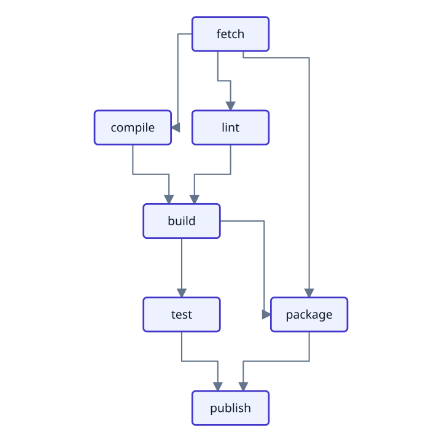](examples/build_pipeline/main.roc) | [Organization chart](examples/org_chart/main.roc) — tree<br>[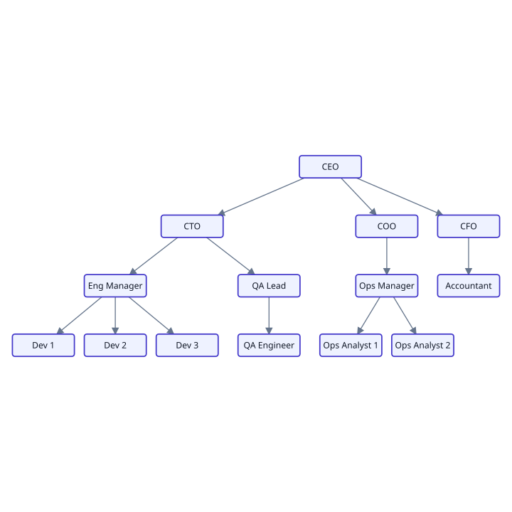](examples/org_chart/main.roc) |
| [Service ring](examples/service_ring/main.roc) — circular<br>[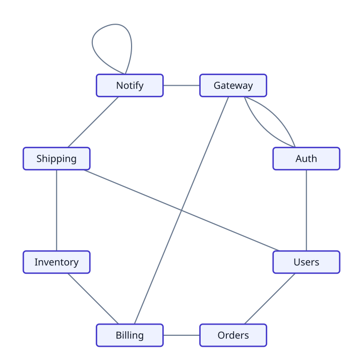](examples/service_ring/main.roc) | [Mind map](examples/mind_map/main.roc) — radial tree<br>[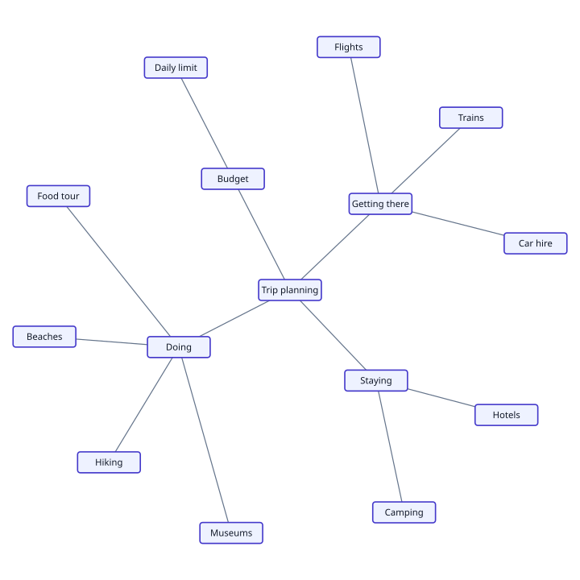](examples/mind_map/main.roc) |
| [Collaboration network](examples/collab_network/main.roc) — force-directed<br>[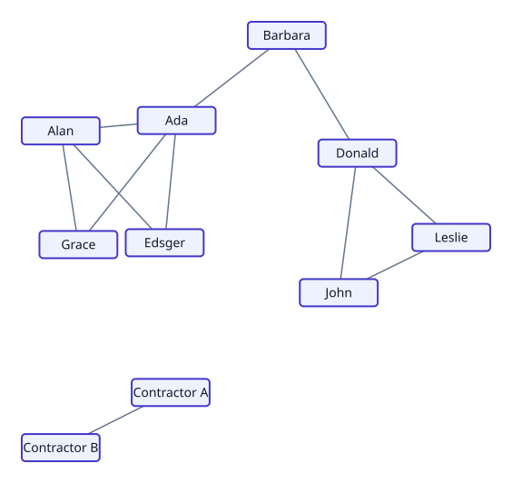](examples/collab_network/main.roc) | [Incident blast radius](examples/incident_blast_radius/main.roc) — radial graph<br>[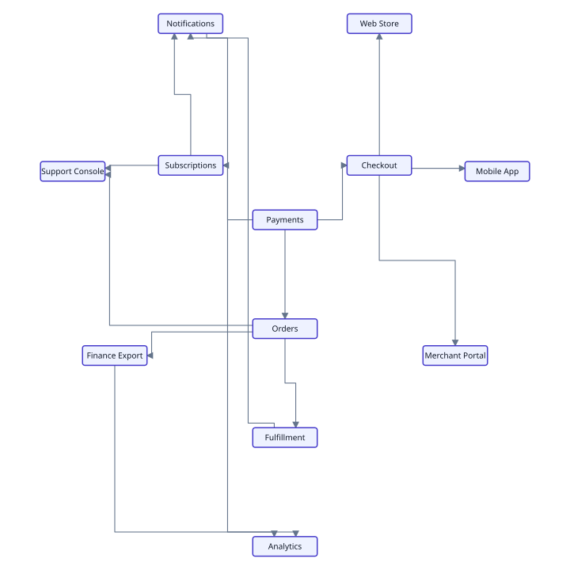](examples/incident_blast_radius/main.roc) |
| [Cloud deployment](examples/cloud_deployment/main.roc) — compound<br>[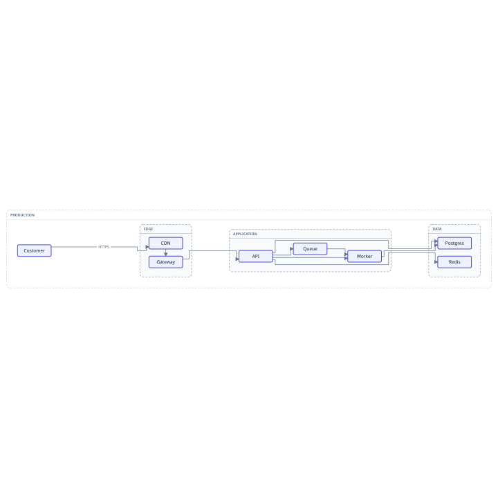](examples/cloud_deployment/main.roc) | [Release workflow](examples/release_workflow/main.roc) — constrained<br>[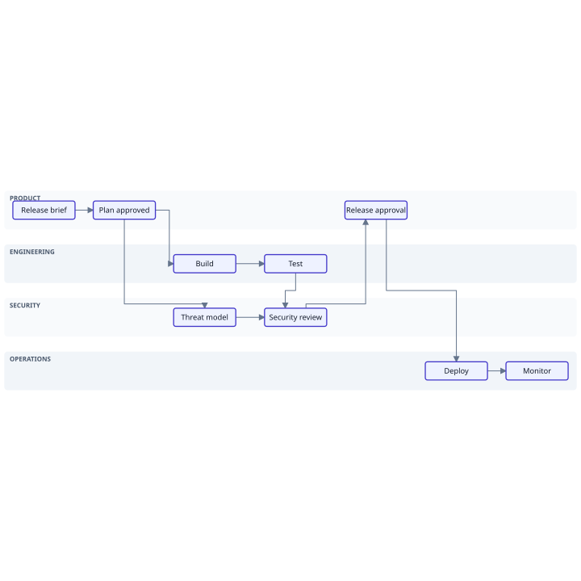](examples/release_workflow/main.roc) |
| [Transit network](examples/transit_network/main.roc) — stress<br>[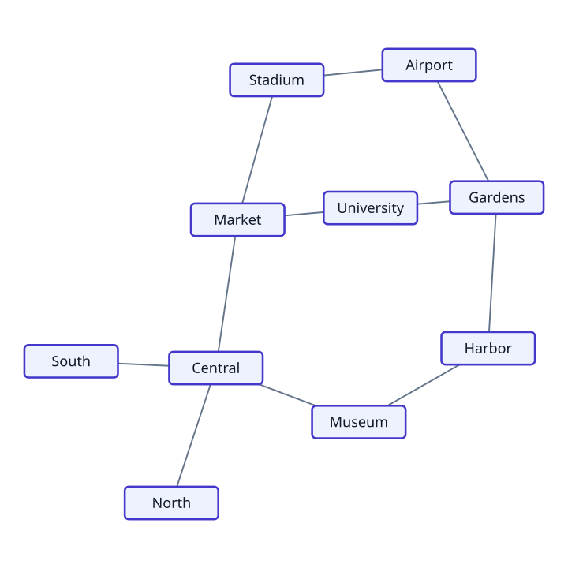](examples/transit_network/main.roc) | |
| [UML component diagram](examples/uml_component/main.roc) — compound<br>[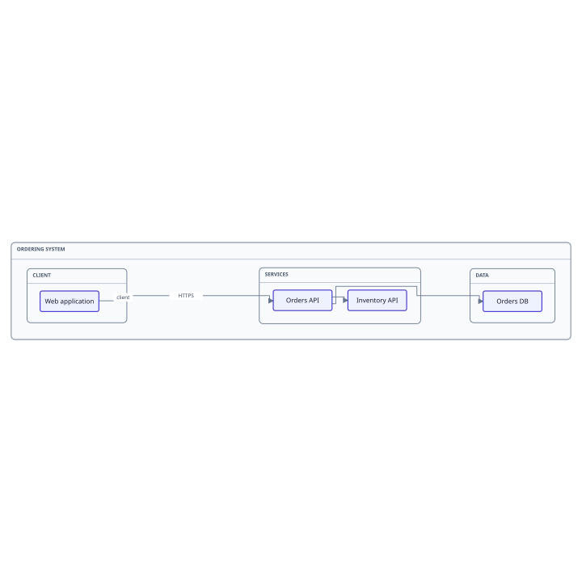](examples/uml_component/main.roc) | [UML class diagram](examples/uml_class/main.roc) — layered and routed<br>[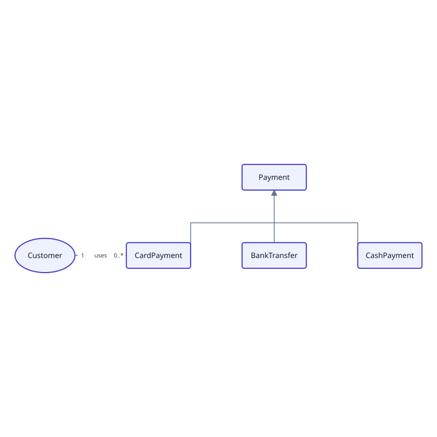](examples/uml_class/main.roc) |
| [Mermaid conversation](examples/mermaid_sequence/main.roc)<br>[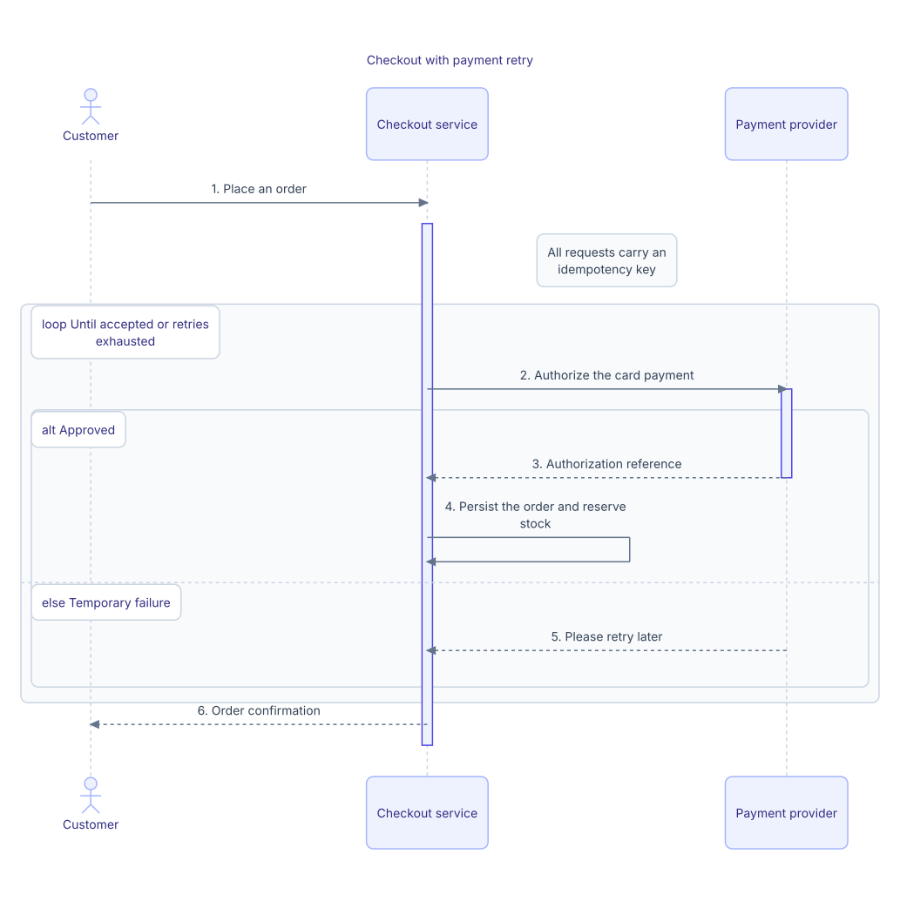](examples/mermaid_sequence/main.roc) | [Mermaid database model](examples/mermaid_entity/main.roc)<br>[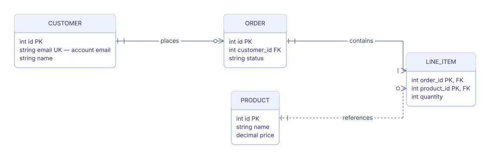](examples/mermaid_entity/main.roc) |
| [Mermaid class model](examples/mermaid_class/main.roc)<br>[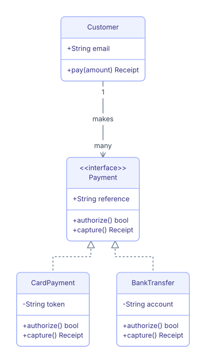](examples/mermaid_class/main.roc) | [Mermaid lifecycle](examples/mermaid_state/main.roc)<br>[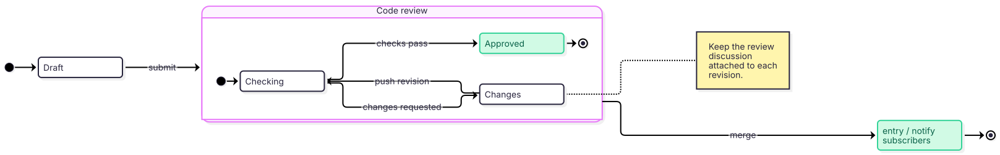](examples/mermaid_state/main.roc) |

See the [build-pipeline example](examples/build_pipeline/main.roc) for a
complete program that writes the result as SVG, the
[org-chart example](examples/org_chart/main.roc) for a level-by-level tree,
the [mind-map example](examples/mind_map/main.roc) for a radial tree, the
[service-ring example](examples/service_ring/main.roc) for a circular graph,
and the [collab-network example](examples/collab_network/main.roc) for a
force-directed graph with a disconnected component. The
[incident blast-radius example](examples/incident_blast_radius/main.roc) uses
concentric dependency hops, the
[cloud-deployment example](examples/cloud_deployment/main.roc) composes nested
infrastructure groups, and the
[release-workflow example](examples/release_workflow/main.roc) keeps work in
domain-specific responsibility lanes. The
[transit-network example](examples/transit_network/main.roc) shares its plain
graph fixture with the browser playground and uses stress layout so drawn
distance reflects network distance.

For repeated layouts of the same input and settings, use `Layered.prepare` once
and pass the result to `Layered.layout_prepared` with `Layered.default_run`.
Changed input must be prepared again.

The [node editor example](examples/node_editor/README.md) is a native persisted
editor demonstrating graph edits, direction changes, sparse re-layout hints,
drag-to-pin behavior, and authoritative routed geometry.

## Development

Install [Blueprint](https://github.com/lukewilliamboswell/roc-blueprint/releases/tag/0.8.0)
and put the latest Roc nightly on your `PATH` as `roc`. The package floats
with the nightly; Blueprint provides the fixed compiler that runs the scripts
under `scripts/`, and Zig for the benchmark host.

```sh
blueprint run check                  # everything CI checks
blueprint run examples               # run the examples, compare their output
blueprint run examples -- --update   # record what the examples print
blueprint run serve                  # build the site and preview it locally
blueprint run bench -- smoke         # native optimized benchmarks
```

The guide is AsciiDoc in `docs/index.adoc` and its chapters, rendered by
roc-automation's shared `roc-docs` utility into the site and a PDF; release
notes live in `docs/releases/`.

`tests/examples.json` records what each example prints, and each example
rewrites its drawing beside its source, so `git diff` shows any change.
